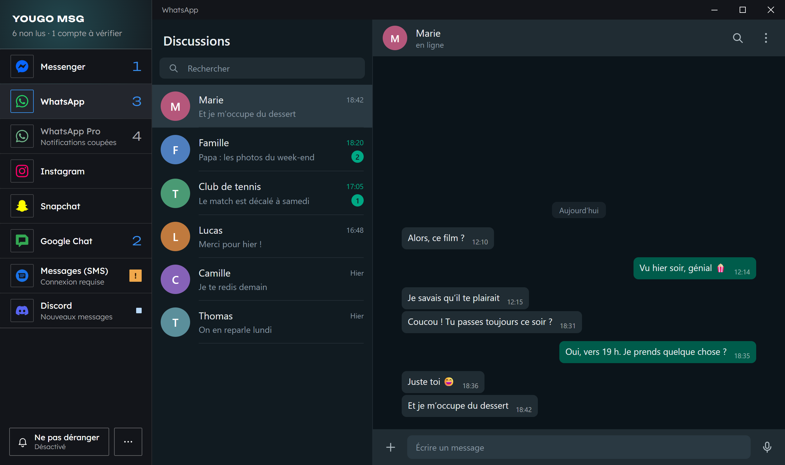
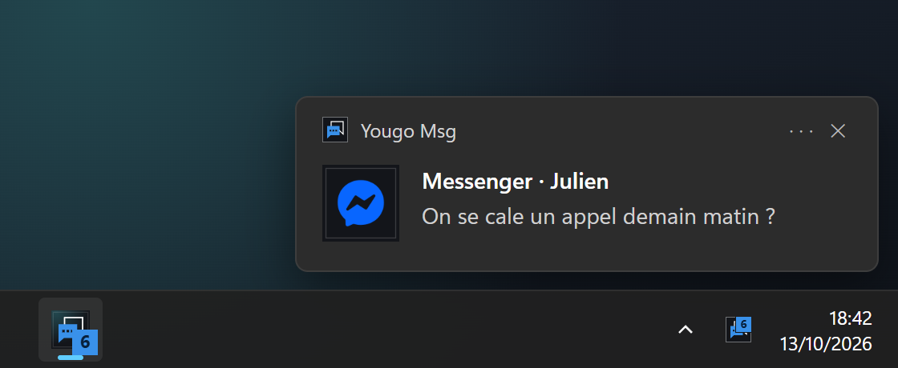
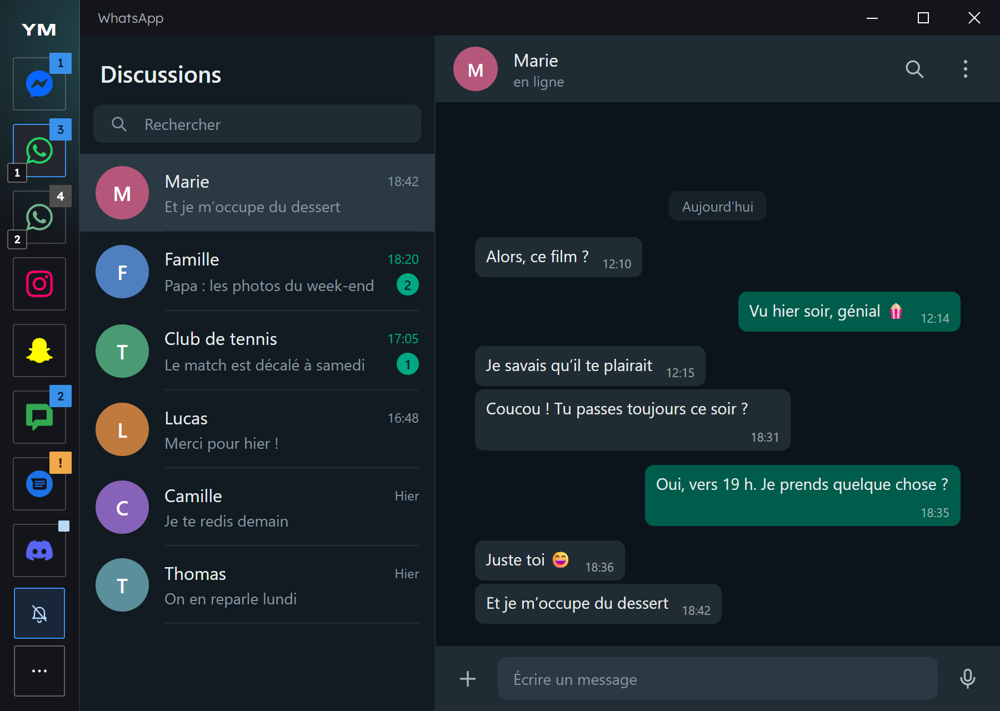

<p align="center">
  
</p>

<h1 align="center">Yougo Msg</h1>

<p align="center">
  <strong>Toutes mes messageries dans une seule fenêtre.</strong><br>
  Une barre à gauche, la messagerie à droite, et je vois d'un coup d'œil où l'on m'a écrit.
</p>

<p align="center">
  <a href="https://github.com/yougo96/yougo_msg/releases/latest"><strong>Télécharger</strong></a>
  &nbsp;·&nbsp; <a href="#installer">Installer</a>
  &nbsp;·&nbsp; <a href="#au-quotidien">Au quotidien</a>
  &nbsp;·&nbsp; <a href="#développer">Développer</a>
  <br><sub>Windows 11 et Linux · sans serveur · sans télémétrie</sub>
</p>

<p align="center">
  
  <br><sub>Comptes et conversations de démonstration.</sub>
</p>

## Pourquoi

Mes conversations sont éparpillées entre sept messageries, chacune dans son onglet ou son app. Je change sans arrêt de fenêtre, je ne sais jamais d'un coup d'œil où l'on m'attend, et je rate des messages, ou je suis noyé de notifications sans savoir d'où elles viennent.

Yougo Msg les rassemble **sans les refaire** : l'app affiche les versions web officielles, telles quelles, chacune avec sa propre session. Aucun serveur intermédiaire : les messages restent entre la machine et chaque service. L'intention, les principes et les limites sont dans le [playbook](PLAYBOOK_yougo_msg.md).

## Les messageries

<table align="center">
  <tr>
    <td align="center" width="104"><br><sub>Messenger</sub></td>
    <td align="center" width="104"><br><sub>WhatsApp</sub></td>
    <td align="center" width="104"><br><sub>Instagram</sub></td>
    <td align="center" width="104"><br><sub>Snapchat</sub></td>
    <td align="center" width="104"><br><sub>Google Chat</sub></td>
    <td align="center" width="104"><br><sub>Google Messages (SMS)</sub></td>
    <td align="center" width="104"><br><sub>Discord</sub></td>
  </tr>
</table>

Telegram et LinkedIn s'ajoutent depuis le menu ⋯ → *Ajouter une messagerie*. Plusieurs comptes d'une même messagerie cohabitent, chacun avec sa session : WhatsApp et WhatsApp Pro dans l'aperçu ci-dessus. Ajouter une messagerie au catalogue tient en une entrée (voir [Ajouter une messagerie](#ajouter-une-messagerie)).

## Ce que ça change

### Je sais tout de suite où l'on m'a écrit

En tête de la barre : le total des non-lus et les comptes à vérifier. À droite de chaque compte, un seul signe :

- **un nombre** : les messages non lus ;
- **un petit carré clair** : des nouveaux messages, sans nombre (Discord sans mention, par exemple) ;
- **un ! orange** : il faut y aller (connexion requise, hors ligne, page plantée), avec l'explication sous le nom.

Le total des comptes non coupés s'affiche aussi dans le titre de la fenêtre, sur l'icône de la barre des tâches et sur celle près de l'horloge.

### Je passe d'une messagerie à l'autre instantanément

Un clic, ou `Ctrl+1` … `Ctrl+9`. Les pages restent ouvertes en arrière-plan (sauf les comptes mis en [veille](#mémoire-et-veille)) et chaque compte garde sa session : on ne se reconnecte jamais. Une messagerie masquée ne marque rien comme lu. On réordonne les comptes en les glissant.

### Je ne rate rien, et je fais taire le reste

<p align="center">
  
</p>

Les notifications portent le nom du compte (« Messenger · Julien ») et leur clic ouvre la bonne conversation. Un compte se coupe d'un clic droit. *Ne pas déranger*, en bas de la barre, fait taire tout le monde pendant une heure, jusqu'à demain 8 h ou jusqu'à ce qu'on le désactive. Une messagerie qui ne notifie pas d'elle-même (Discord par défaut) déclenche une notification « Nouveau message » quand son compteur monte.

### Elle se fait oublier

- Elle démarre avec le PC, directement près de l'horloge.
- Fermer la fenêtre ne la quitte pas : elle continue de recevoir les messages.
- Elle se met à jour seule depuis les [releases](https://github.com/yougo96/yougo_msg/releases), et propose de redémarrer quand la nouvelle version est prête.
- Elle se comporte comme une vraie app, pas comme un assemblage de sites : sous Windows, elle dessine même sa barre de titre à ses couleurs.

### Elle s'adapte à la fenêtre

<p align="center">
  
</p>

Sous 1200 px de large, la liste se replie en colonne d'icônes pour laisser la place à la page. Les indicateurs deviennent des pastilles, un petit numéro distingue les comptes d'une même messagerie, et le survol donne le détail. Ici, *Ne pas déranger* est activé : la cloche barrée, en bleu.

### Rien ne sort de la machine

- Pas de serveur ni de télémétrie : chaque page parle directement à son service.
- Le journal ne contient jamais le texte des messages : des nombres et des états, rien d'autre.
- L'app elle-même ne fait que deux types de requêtes : la lecture de la dernière version publiée sur GitHub (sans rien qui identifie la machine) et, sous Linux, le téléchargement des dictionnaires du correcteur orthographique.

## Installer

### Windows

Télécharger `Yougo-Msg-Setup-<version>.exe` dans les [releases](https://github.com/yougo96/yougo_msg/releases) et le lancer. L'app n'est pas signée : à la première installation, Windows affiche « Windows a protégé votre ordinateur » → *Informations complémentaires* → *Exécuter quand même*. Elle se met ensuite à jour seule (voir [Mises à jour](#mises-à-jour)).

### Linux

Le `.deb` et l'AppImage sont dans les [releases](https://github.com/yougo96/yougo_msg/releases). Sinon, `npm install` puis `npm run dist` **sur la machine Linux** les produit dans `dist/`.

- **Ubuntu / Debian** : `sudo apt install ./Yougo-Msg-<version>.deb` (recommandé : raccourci, icône et bac à sable de Chromium actifs).
- **AppImage** (Fedora…) : `chmod +x` puis lancer. Elle crée son raccourci et son icône au premier lancement. Elle a besoin de `libfuse2` (`libfuse2t64` sur Ubuntu 24.04). Sur Ubuntu 24.04+, une AppImage Electron tourne sans le bac à sable de Chromium : préférer le `.deb`.
- **Icône près de l'horloge** : native sous KDE ; sous GNOME, il faut l'extension AppIndicator (installée d'office sur Ubuntu). Sans elle, Yougo Msg le détecte et fermer la fenêtre la **réduit** au lieu de la cacher. Sous GNOME, l'icône s'ouvre d'un double-clic ; le clic droit donne le menu.
- **Sessions** : les cookies sont stockés sans chiffrement par Electron (comme dans le POC) ; elles ne dépendent donc pas du trousseau GNOME/KDE. La protection repose sur le chiffrement du disque.
- **Correcteur orthographique** : les dictionnaires français et anglais sont téléchargés une fois depuis Google au premier usage (aucun texte n'est envoyé). Sous Windows, c'est le correcteur du système.

### Premier lancement

Chaque messagerie demande de se connecter (QR code pour WhatsApp, Google Messages et, si on le souhaite, Discord). Les sessions sont conservées. Si Google refuse la connexion, voir [plus bas](#si-une-connexion-google-est-refusée).

### En venant de HP Message

C'est l'ancien nom de l'app, et celui du POC. Au premier lancement, Yougo Msg reprend son profil, donc ses connexions, ses comptes et ses réglages. La version installée remplace aussi son lancement au démarrage. Il faut d'abord quitter HP Message (clic droit sur son icône près de l'horloge → *Quitter*) : tant qu'il est ouvert, Yougo Msg le signale et s'arrête. Ensuite, désinstaller HP Message (Paramètres → Applications ; sous Linux, `sudo apt remove hp-message`).

## Au quotidien

- **Barre latérale** : un clic ouvre une messagerie, `Ctrl+1` … `Ctrl+9` aussi. On réordonne en glissant les comptes. Les indicateurs sont décrits [plus haut](#je-sais-tout-de-suite-où-lon-ma-écrit).
- **Clic droit sur un compte** : couper les notifications de ce compte, le mettre en [veille](#mémoire-et-veille), recharger, revenir à l'accueil, renommer, ajouter un autre compte du même service, réparer (vider le cache), retirer.
- **Ne pas déranger** (en bas de la barre) : un clic l'active ou le coupe, clic droit pour une durée (1 h, jusqu'à demain 8 h).
- **⋯** : mise à jour, ajouter une messagerie (dont Telegram et LinkedIn), lancer au démarrage, diagnostic, journaux, quitter.
- **Fermer la fenêtre ne quitte pas** : Yougo Msg reste près de l'horloge pour continuer à recevoir les messages. Pour quitter : clic droit sur l'icône près de l'horloge, ou menu ⋯.
- **Démarrage avec le PC** : activé d'office dans la version installée (désactivable dans ⋯). L'app démarre alors directement dans la zone de notification.

### Notifications

Elles portent le nom du compte (« WhatsApp 2 · Marie ») et un clic ouvre la bonne conversation. Un compte coupé, ou *Ne pas déranger*, ne notifie plus et sa page se tait tant qu'elle n'est pas affichée (un appel en cours n'est pas coupé). Une messagerie qui ne notifie pas elle-même (Discord par défaut, par exemple) déclenche une notification « Nouveau message » quand son compteur monte (pour Discord : seulement les mentions et les messages privés).

### Mémoire et veille

Chaque messagerie ouverte est une vraie page web qui garde sa mémoire : de 100 à 400 Mo une fois connectée (Google Chat et Discord en tête), soit 2 à 3 Go pour les sept. Pour un compte qu'on peut consulter de temps en temps : clic droit → **Veille après 10 min**. Dix minutes après qu'on l'a quitté, sa page se ferme et rend toute sa mémoire ; elle se recharge en quelques secondes quand on rouvre le compte. En veille, le compte ne reçoit ni notifications ni compteur de non-lus (« En veille » sous son nom). Il n'est pas chargé au démarrage, sauf s'il est affiché. Jamais le compte affiché ni un compte en appel.

Un compte resté sur sa page de connexion se met en veille de lui-même au bout de 10 min, puisqu'il ne peut rien recevoir. La fenêtre Diagnostic donne la mémoire de chaque compte, de quoi choisir lesquels mettre en veille.

### Raccourcis

| Raccourci | Action |
| --- | --- |
| `Ctrl+1` … `Ctrl+9` | Aller au compte n° 1 à 9 |
| `Ctrl+Tab` / `Ctrl+Maj+Tab` | Compte suivant / précédent |
| `Ctrl+R` ou `F5` | Recharger le compte affiché (`Ctrl+Maj+R` : sans le cache) |
| `Ctrl+molette`, `Ctrl+=` / `Ctrl+)` , `Ctrl+0` | Zoom du compte affiché (mémorisé), retour à 100 % |
| `Ctrl+Maj+I` ou `F12` | Outils de développement du compte affiché |

### Mises à jour

La version installée regarde au démarrage, puis toutes les 6 h, si une version plus récente est publiée dans les [releases](https://github.com/yougo96/yougo_msg/releases) du dépôt, et la télécharge en arrière-plan. Quand elle est prête : une notification, une pastille sur **⋯**, et *Redémarrer pour passer à la version x.y.z* dans le menu ⋯ comme dans celui de l'icône près de l'horloge. Sans ce clic, elle s'installe quand on quitte l'app (Windows, AppImage). ⋯ → *Rechercher une mise à jour* vérifie tout de suite. La requête vers GitHub lit seulement la dernière version publiée : rien n'y identifie la machine.

- **Linux, `.deb`** : l'installation demande le mot de passe administrateur, et seulement sur *Redémarrer* (jamais en quittant).
- **AppImage** : la nouvelle, qui porte son numéro de version, remplace l'ancienne dans le même dossier ; le raccourci et le lancement au démarrage la suivent.
- Rien en développement (`npm start`) ni avec un profil de test (`YOUGO_MSG_USER_DATA`).
- **Depuis la 0.2.0**, qui n'a pas encore ce mécanisme : installer une fois à la main la première version publiée.

### Si une connexion Google est refusée

Google refuse parfois les connexions depuis une app de bureau. Clic droit sur Google Chat ou Messages → **Connexion Google : mode compatibilité**, puis se connecter. Une fois connecté, on peut désactiver le mode : la session reste.

### Diagnostic

Menu ⋯ → **Diagnostic** : l'état des mises à jour (dernière vérification, échec), puis, pour chaque compte, l'état, d'où vient le compteur de non-lus (titre, lecture de la page, favicon) et ce que la page affiche, les notifications reçues, la mémoire et la visibilité. *Copier le rapport* donne un texte à coller ailleurs. Le journal (`%APPDATA%\Yougo Msg\logs`, ou `~/.config/Yougo Msg/logs`) note les échecs de chargement, les plantages, l'évolution des compteurs (des nombres, jamais le texte des messages) et un relevé mémoire tous les quarts d'heure. De quoi répondre aux questions ouvertes du playbook.

### Limites connues, à vérifier à l'usage

- **Compteurs** : fiables par construction sur WhatsApp, Messenger et Discord (titre). Pour Instagram, Google Chat et Google Messages, ils viennent d'une lecture de la page qui peut casser à une mise à jour du site : le diagnostic montre alors « lecture : null » et la source de repli. Snapchat n'a pas été vérifié avec un compte connecté.
- **Notifications** : relais testé avec des notifications simulées ; à confirmer avec de vrais messages pour chaque service.
- **Connexion Google** dans l'app : à confirmer (mode compatibilité en secours).
- **Fenêtre ouverte** : tant qu'une partie de la fenêtre se voit à l'écran, le compte affiché est considéré comme lu par sa messagerie (comme un onglet ouvert dans un navigateur). Sous Windows, une fenêtre entièrement recouverte, ou l'écran éteint, ne marque rien comme lu.
- **messenger.com** répond toujours (vérifié le 13/10/2026) malgré l'annonce de sa fermeture ; `facebook.com` est autorisé dans la vue si Meta y redirige.

## Développer

Node.js 22.12 ou plus (24 conseillé, cf. `.nvmrc`), puis :

```powershell
npm install   # une seule fois
npm start
```

`npm start` utilise le même profil que la version installée, donc les vraies sessions. Les deux ne tournent pas en même temps : le second lancement ouvre simplement la fenêtre du premier.

| Commande | Rôle |
| --- | --- |
| `npm start` | Lance l'app (profil réel) |
| `npm test` | Tests unitaires des modules sans Electron |
| `npm run smoke` | Test de bout en bout, avec un profil temporaire (environ 2 min, réseau requis) |
| `npm run dist` | Installeur Windows, ou `.deb` + AppImage sous Linux, dans `dist/` |
| `npm run icons` | Régénère les icônes de l'app et des messageries |
| `npm run screenshots` | Régénère les images de ce README (`docs/`) |
| `npm run update:electron` | Passe au dernier Electron (voir plus bas) |
| `npm version patch` | Publie une version (voir plus bas) |

### Tests

- `npm test` : règles pures (compteurs, navigation, permissions, réglages, catalogue).
- `npm run smoke` : lance la vraie app avec un **profil temporaire** (jamais le vôtre) sur les vraies pages des messageries, déconnectées. Il vérifie l'interception des notifications et le clic rejoué, la passkey silencieuse, la visibilité des pages masquées, les compteurs, la navigation, les permissions, la reprise après panne, et la veille (page et processus fermés, puis réveil). Il fait aussi tourner electron-updater contre un serveur local qui annonce une version 99.0.0 : téléchargement, notification, pastille, puis *Redémarrer*, qui doit fermer les pages avant l'installeur (simulé) et terminer le processus vite.

### Ajouter une messagerie

Une entrée dans [`src/services.js`](src/services.js) et le tracé du logo en SVG dans `assets/services/<id>.svg` : on le prend sur [Simple Icons](https://simpleicons.org) et on met la couleur de la marque dans `fill`. Ensuite, `npm run icons` produit l'icône de la barre (256 px, fond transparent) et celle des notifications. Le minimum de l'entrée : `id`, `name`, `url`, `color`, `hosts` (domaines où la page peut naviguer). Par défaut, le compteur de non-lus est lu dans le titre (« (3) Service »). Les autres options (lecture de la page, favicon, fenêtres d'appel, page de connexion…) sont décrites en tête du fichier. `npm test` vérifie que l'entrée est complète.

Ajouter un service au catalogue ne le crée pas chez soi : il apparaît dans ⋯ → *Ajouter une messagerie* (ou d'office au premier lancement si `enabled` n'est pas `false`).

### Apparence

La DA reprend celle de [pradierh.fr](https://pradierh.fr) : fond sombre, bleu, angles vifs et filets fins. Les couleurs et les polices sont dans `src/ui/theme.css`. Sous Windows, la barre de titre est dessinée par l'app. L'icône est dessinée en vectoriel dans `src/ui/sidebar/badge-art.js`, avec les pastilles de la zone de notification et de la barre des tâches. Après une modification, `npm run icons` régénère les fichiers de `assets/`.

Les images de ce README sont produites par `npm run screenshots` : la vraie barre latérale, remplie de comptes de démonstration, à côté d'une page de messagerie, d'une notification et d'une barre des tâches dessinées par le script. Aucun vrai compte ni message n'y figure. À relancer après un changement visible de la barre.

### Publier une version

```powershell
npm version patch   # ou minor : lance npm test, passe package.json à la version suivante, committe « chore: version x.y.z » et crée le tag vx.y.z
git push --follow-tags
```

Le tag lance le [workflow Release](.github/workflows/release.yml) sur GitHub Actions. Il construit l'installeur Windows, le `.deb` et l'AppImage, puis publie la release avec la liste des commits depuis la précédente (une dizaine de minutes, onglet *Actions* du dépôt). Les apps installées la proposent dans les 6 h. Le dépôt doit rester public : l'app lit les releases sans clé.

### Mettre à jour Electron (et donc Chromium)

Chromium arrive avec Electron : il ne se met à jour que si l'on passe à un Electron récent, puis qu'on publie une version. À faire régulièrement : le menu ⋯ et le diagnostic préviennent quand l'Electron embarqué a plus de 60 jours.

```powershell
npm run update:electron
npm test
npm run smoke
npm run dist
```

Après une nouvelle version majeure d'Electron, vérifier aussi à la main : changement de compte, clic sur une notification, fermeture de l'app. Ensuite, [publier une version](#publier-une-version).

### Structure

```
src/
  main.js            démarrage, instance unique, branchements, fermeture propre
  services.js        catalogue des messageries (ajouter un service = une entrée + une icône)
  hub.js             fenêtre, comptes, sélection, ne pas déranger, indicateurs, menus
  views.js           vue d'un compte : navigation, fenêtres d'appel, reprise après panne, lecture des pages
  sessions.js        session d'un compte : permissions, partage d'écran, correcteur
  notifications.js   notifications (nom du compte, clic, rafales, « Nouveau message »)
  unread.js          compteur de non-lus d'un compte (titre, page, favicon, pastille)
  policy.js          règles de navigation, de fenêtres, de permissions et de veille
  accounts.js, settings.js   comptes et réglages (écriture atomique, reprise du POC)
  legacy.js          reprise de l'ancien nom, HP Message (profil, lancement au démarrage)
  updates.js         mises à jour depuis les releases GitHub (electron-updater)
  tray.js, autostart.js, linux.js, context-menu.js, diagnostics.js, dialogs.js, log.js
  preload/           ponts : barre latérale, petites fenêtres, et service.js injecté dans les messageries
  ui/                barre latérale, Diagnostic, Renommer ; theme.css (DA de pradierh.fr), titlebar.js (bande de titre Windows),
                     fonts/ (Unbounded, Lexend, licence OFL)
  titlebar.js        barre de titre à la DA sous Windows (options des fenêtres de l'app)
test/                tests (node:test) et test de bout en bout (smoke)
assets/              icône de l'app (PNG, ICO pour Windows, SVG de référence), pastille de secours ; services/ : logos des messageries (SVG, tuiles des notifications)
docs/                images de ce README (npm run screenshots), hors de l'app installée
scripts/             icons.js (régénère les icônes), screenshots.js (images du README), stamp.js (date de l'Electron embarqué)
.github/workflows/   release.yml : un tag vx.y.z construit et publie la release
```
